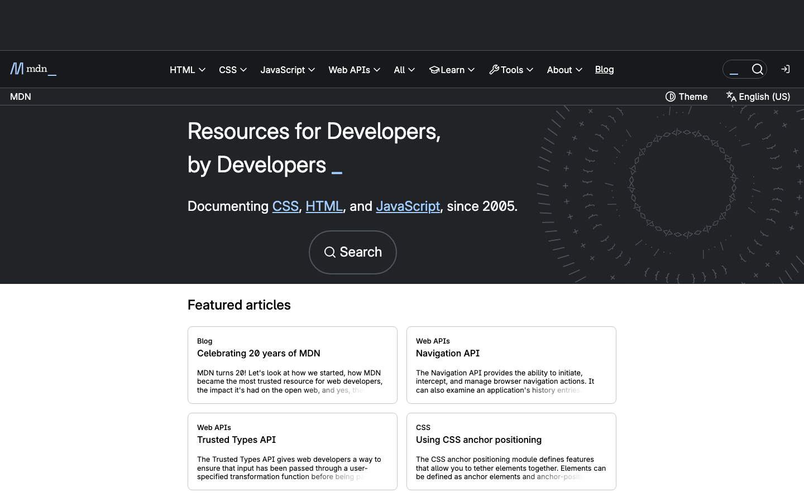

# webpage-audit

[](https://github.com/LifeAyush/webpage-audit/actions/workflows/ci.yml)

Local [MCP](https://modelcontextprotocol.io) server that lets an agent open a real browser, interact with a site, and collect evidence. **The server does not write the audit** — the agent follows the `audit_website` prompt and writes `reports/website-audit.md`.



https://github.com/LifeAyush/webpage-audit

## Why this instead of a generic browser MCP

- **Audit checklist** — `audit_website` prompt (also exposed as MCP resource `webpage-audit://checklist`)
- **Safety defaults** — blocks payment/account buttons and password fills unless explicitly allowed
- **Evidence discipline** — console, network, Navigation Timing, axe; no invented Lighthouse scores
- **Agent-authored reports** — sample MDN and Wikipedia audits are tracked in-repo

MIT licensed. The package is private and is not published to npm.

## Quick start

Requires Node.js 20+.

```bash
git clone https://github.com/LifeAyush/webpage-audit.git
cd webpage-audit
npm install
npm start
```

`postinstall` downloads Chromium. If needed later: `npx playwright install chromium`.

Or run the bin entry after install: `npx webpage-audit` (same as `npm start`).

**MCP Inspector** (no Cursor required):

```bash
npx @modelcontextprotocol/inspector npx tsx src/server.ts
```

Optional environment variables:

| Variable | Effect |
| --- | --- |
| `HEADED=1` | Show the browser window |
| `ALLOWED_HOSTS` | Comma-separated hostnames; other hosts are rejected on navigate |

One Chromium stays open for the conversation. `browser_navigate` reuses the context on the same hostname and starts a fresh one when the host changes (`www` and apex count as different hosts).

## Use it from Cursor

This repo registers the server as **webpage-audit** in [`.cursor/mcp.json`](.cursor/mcp.json):

```json
{
  "mcpServers": {
    "webpage-audit": {
      "command": "npx",
      "args": ["tsx", "src/server.ts"]
    }
  }
}
```

1. Open this folder in Cursor.
2. In Settings → MCP, enable **webpage-audit**.
3. Ask the agent to audit a URL, or run the `audit_website` prompt.

[`.cursor/rules/website-audit.mdc`](.cursor/rules/website-audit.mdc) tells the agent to fetch that prompt (`url` required, `instructions` optional).

```text
Use the audit_website prompt for https://developer.mozilla.org/.
In instructions, focus on the homepage search and one documentation page.
Do not submit forms that cause real-world side effects.
```

## Sample audits

Logged-out reviews (homepage at both viewports plus one linked page):

- [MDN Web Docs](reports/mdn-website-audit.md)
- [English Wikipedia](reports/wikipedia-website-audit.md)

Screenshots: [reports/samples](reports/samples).

## Tools

`browser_snapshot` returns a nested accessibility tree. Interactive nodes are marked `[ref=e1]`. Refs work only until the next snapshot. Very large trees are retaken at a smaller depth or truncated (~40,000 characters).

`browser_wait` takes exactly one of `text`, `ref`, or `loadState` (`load` or `domcontentloaded`). `timeoutMs` defaults to 5s and is capped at 15s.

| Tool | What it does |
| --- | --- |
| `browser_navigate` | Open an `http`/`https` URL; result says `Context: fresh` or `Context: reused` |
| `browser_go_back` | Previous page in this tab |
| `browser_wait` | Wait for text, ref, or load state |
| `browser_snapshot` | Accessibility tree with refs |
| `browser_click` | Click a ref (payment/account buttons rejected) |
| `browser_fill` | Fill a ref (password/payment need `allowSensitive`) |
| `browser_press` | Key on a ref (Enter/Space use the same button block) |
| `browser_hover` | Hover a ref |
| `browser_scroll` | Scroll; optional ref into view |
| `browser_set_viewport` | `desktop` (1440×900) or `mobile` (390×844) |
| `browser_screenshot` | PNG under `reports/screenshots/` |
| `browser_console` | Errors/warnings since last navigation |
| `browser_network` | Failed requests and 4xx/5xx |
| `browser_page_info` | Title, meta, headings, missing alt, links |
| `browser_performance` | Navigation Timing (not Lighthouse) |
| `browser_accessibility` | axe-core violations |
| `browser_close` | Close the browser |

Page text is wrapped in `<untrusted-page-content>`.

**Resource:** `webpage-audit://checklist` — same workflow text agents can discover without only relying on prompts.

## Limits

- Only `http` and `https`; embedded credentials rejected.
- Password / `cc-*` / card-like fields need `allowSensitive` (only when the user asked).
- Buttons named pay, purchase, checkout, sign in, register, etc. are rejected; links with those names can still open.
- No CAPTCHA / auth / rate-limit bypass.
- Empty console or network means none captured; axe Incomplete is not a confirmed failure.

## Checks

```bash
npm run typecheck
npm test
npm run smoke
npm run mcp-smoke
```

- `test` — unit tests for refs, URL rules, and safety helpers (`node:test`)
- `smoke` — fixture browser path including hover, press, scroll, and safety rejects
- `mcp-smoke` — stdio client; lists tools, reads the checklist resource, loads `audit_website`, and **invokes all 17 tools** on the fixture

GitHub Actions runs those on Node 20 for pushes and pull requests.
